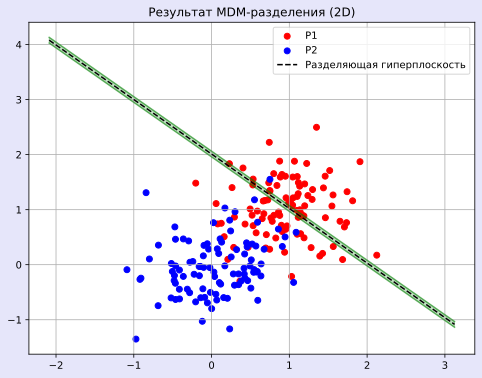

# MDM: линейное разделение двух множеств

Учебная работа по реализации MDM-алгоритма с графическим интерфейсом. Приложение генерирует два множества точек и строит разделяющую прямую в 2D или плоскость в 3D.

**Python, NumPy, Matplotlib, Tkinter.**

## Возможности

- Выбор числа точек на класс, размерности и параметра `C`.
- Повторяемая генерация с `seed=45` или новые случайные точки при каждом запуске.
- Вывод вектора нормали, смещения, числа итераций, суммы отклонений от отступа и доли правильно классифицированных точек.
- Визуализация двух классов и разделяющей границы.

## Запуск

Python 3.11 с Tkinter:

```bash
python -m pip install -r requirements.txt
python app.py
```

В окне задайте параметры и нажмите **«Запустить MDM»**. Число точек указывается для каждого класса отдельно. Показанная доля верных ответов считается на тех же сгенерированных точках, а не на отдельной тестовой выборке.



## Расчёт

Точки второго класса входят в матрицу с противоположным знаком. На каждой итерации выбирается пара весов внутри одного класса и выполняется ограниченный шаг. Суммы весов классов равны и сохраняются; `C` ограничивает каждый вес сверху. Из полученного вектора восстанавливаются нормаль и смещение, затем вычисляются отклонения `max(0, 1 − y(w·x + beta))`.

Это учебная реализация с фиксированными суммами весов. Параметр `C` здесь не следует напрямую сравнивать с `C` в стандартном SVM. Для пересекающихся множеств идеальное разделение не гарантируется.

## Сборка приложения Windows

```bash
python -m pip install -r requirements-build.txt
python -m PyInstaller --onefile --windowed --name MDMApp app.py
```

Файл приложения появится в `dist/MDMApp.exe`. Для запуска из исходников сборка не нужна.
